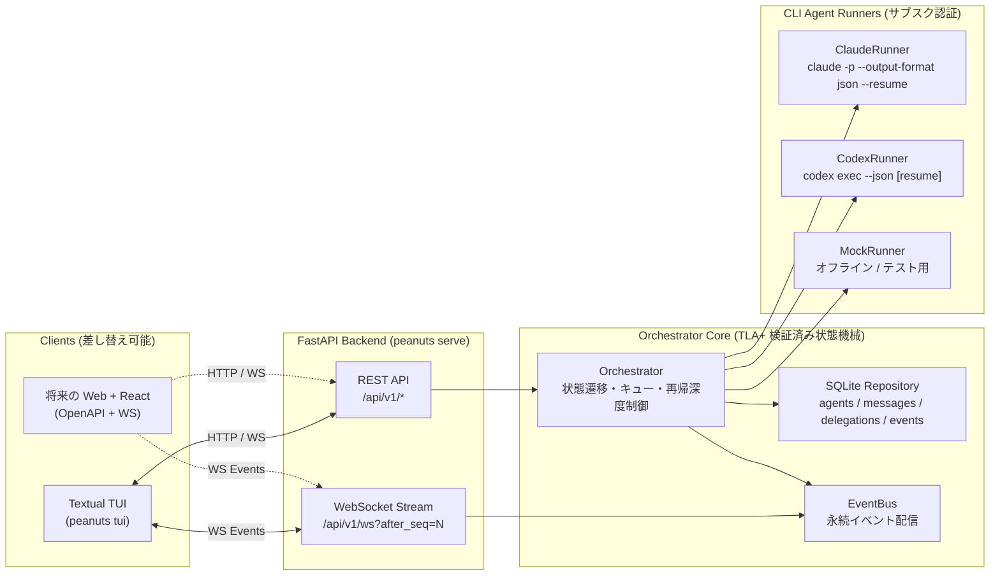
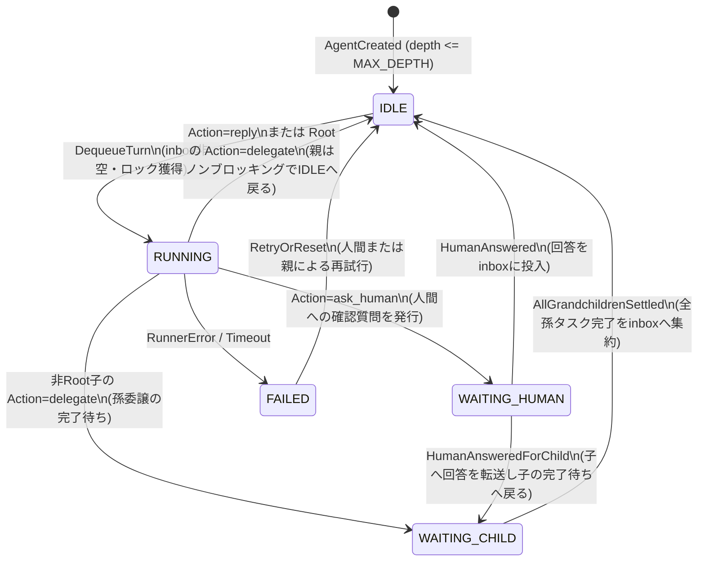
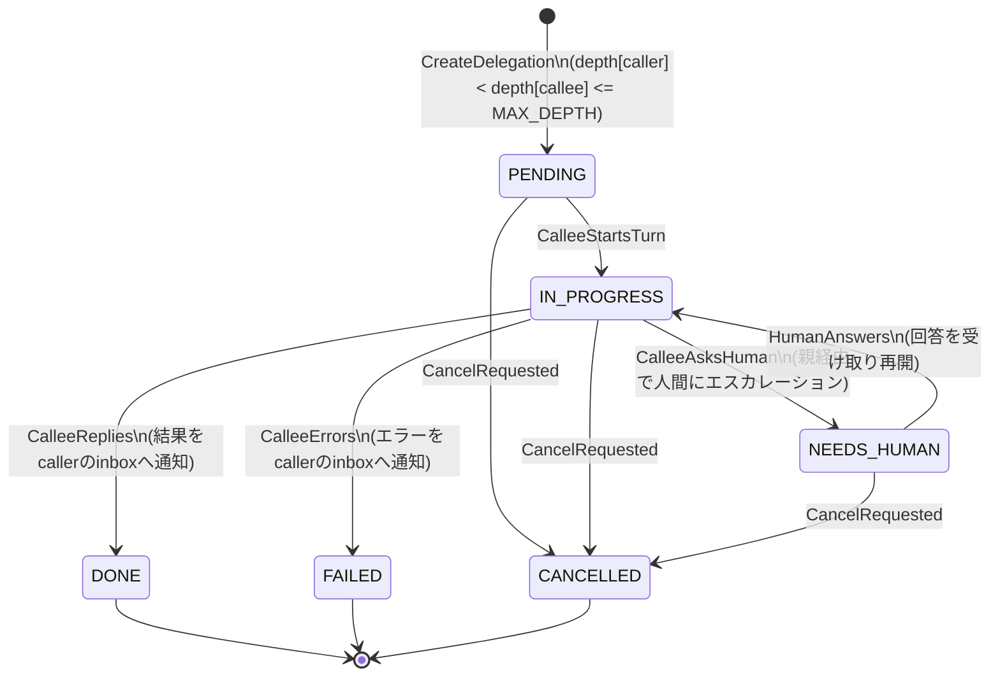
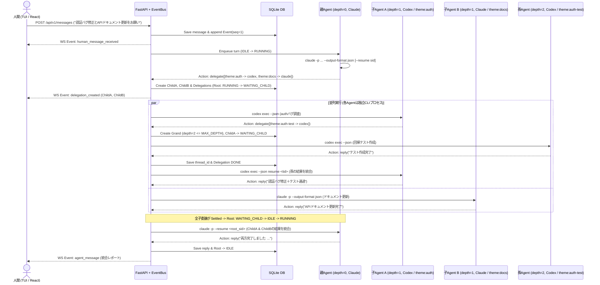
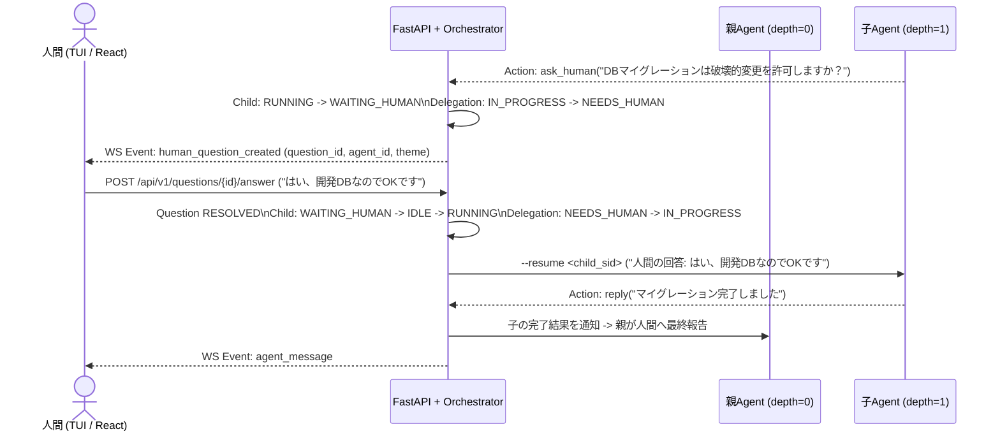

# Peanuts Architecture Design

OpenAI **dots** に着想を得た、**親エージェント（Root Mediator）** が人間と複数の **子エージェント（Claude Code CLI / Codex CLI）** を仲介するマルチエージェント・オーケストレーターの設計書です。

- **サブスク認証前提**: Pay-as-you-go APIキーではなく、既存のサブスクリプション認証済み `claude` CLI (`claude -p --output-format json --resume`) と `codex` CLI (`codex exec --json` / `codex exec --json resume`) をそのまま呼び出します（テスト・オフライン確認用の `mock` プロバイダも同梱）。
- **再帰的委譲（Agent-to-Agent）**: 親エージェントは複数テーマを子エージェント（Claude / Codex）に振り分け、子エージェントも最大深度 `MAX_DEPTH` の範囲内でさらに孫エージェントへ委譲できます。
- **マルチターン永続化**: SQLite にスレッド/テーマ、エージェントツリー、プロバイダ側 `session_id` / `thread_id`、メッセージ履歴、委譲状態、イベントログ（シーケンス番号付き）を保存します。
- **Web + React 即時移行構成**: コアは FastAPI（REST + WebSocket + OpenAPI スキーマ）として公開し、Textual TUI も完全にその API クライアントとして動作します。将来 React フロントエンドを載せる際はそのまま同じエンドポイントに接続できます。

---

## 1. レイヤー構成

---

## 2. 状態遷移図 (State Transition Diagrams)

### 2.1 エージェント状態遷移 (`AgentStatus`)

各エージェント（親・子・孫すべて同一の状態機械）は、TLA+ 仕様 (`spec/PeanutsOrchestrator.tla`) で検証された以下の状態を持ちます。
**重要不変条件**: 同一エージェントに対して同時に2つ以上の CLI ターン（`--resume`）は絶対に走らない（`SingleActiveTurnPerAgent`）。

### 2.2 委譲タスク状態遷移 (`DelegationStatus`)

親→子、子→孫の委譲1件ごとのライフサイクルです。

---

## 3. シーケンス図 (Sequence Diagrams)

### 3.1 複数テーマの振り分け＋子から孫への再帰委譲＋マルチターン

### 3.2 子エージェントからの人間への確認（仲介ループ）

---

## 4. TLA+ による形式検証 (`spec/PeanutsOrchestrator.tla`)

実装前に以下の安全不変条件（Safety）と活性条件（Liveness）を TLC モデルチェッカーで全状態探索します。

| プロパティ | 種別 | 保証する内容 |
| :--- | :--- | :--- |
| `TypeOK` | Safety | 全エージェント・委譲・キュー・質問の状態が定義域内に収まる |
| `DepthBound` | Safety | すべてのアクティブエージェントは `depth <= MaxDepth` を満たす（無限再帰防止） |
| `StrictTreeHierarchy` | Safety | すべての委譲は `depth[caller] < depth[callee]` かつ非巡回（デッドロック防止） |
| `NoConcurrentResume` | Safety | 同一エージェントに同時に実行中のターンは最大1つ（CLI `--resume` 競合防止） |
| `WaitingChildConsistency` | Safety | `WAITING_CHILD` 状態であることと未完了の子委譲が存在することが同値（親の永久ハング防止） |
| `WaitingHumanConsistency` | Safety | `WAITING_HUMAN` 状態であることと未回答の質問が存在することが同値 |
| `RootNeverBlockedOnChildren` | Safety | 親エージェント（`root`）は子委譲で `WAITING_CHILD` にブロックされず常に新テーマを受付可能 |
| `ChildCallerWaitsForGrandchildren` | Safety | 非ルート子エージェントが孫に委譲中は必ず `WAITING_CHILD`（不完全な中間返信を防止） |
| `AtMostOneActiveIncomingDelegation` | Safety | 同一子エージェントが同時に複数のアクティブ委譲を持たない |
| `AllDelegationsEventuallySettle` | Liveness | 弱公平性のもと、すべてのアクティブ委譲は最終的に `DONE`/`FAILED`/`CANCELLED` へ収束する |
| `AllQuestionsEventuallyResolved` | Liveness | すべての未回答質問は最終的に解消される |
| `WaitingParentEventuallyWakes` | Liveness | `WAITING_CHILD` の子エージェントは全孫委譲完了後に必ず起床する |

> **TLC 検証結果 (2026-11-25 / ノンブロッキング親モデル)**: `MaxDepth=2`, `MaxDelegations=2`, `MaxHumanRequests=2`, `MaxQuestionsPerTurn=1` において **16,821 状態生成 / 5,505 個の独立状態** を全探索し、エラー 0 件で通過。
> - 親（`root`）が子 A をバックグラウンド実行したまま `IDLE` へ戻り、直後に新テーマで子 B を追加起動し、各子の完了通知をイベントループの inbox 経由で非同期に受け取る挙動を形式検証済み。
> - 子エージェントが `ask_human` を無限ループする活性違反も `MaxQuestionsPerTurn` 上限により解消済み。

### 4.1 Worktree 分離 + 単一 Integrator (`spec/PeanutsMergeQueue.tla`)

並列コーディング時のファイル競合を防ぐため、以下を [PeanutsMergeQueue.tla](file:///home/ryoyoshikai/ghq/github.com/Kololu777/peanuts/spec/PeanutsMergeQueue.tla) で別途モデル検査しました：

- **起動時ブランチ排他ロック (`flock`)**: `<git-common-dir>/peanuts-locks/<branch-hash>.lock` により、`ghq` の有無に関わらず同一リポジトリ＆同一ブランチでの 2 重起動を拒否。
- **開いたブランチ＝親ブランチ**: 子エージェントは `.peanuts/worktrees/<agent_id>` (`peanuts/<theme>-<id>`) で完全に独立作業し、ターン終了時に自動コミットして `merge_jobs` キューへ投入。
- **単一 Integrator（Single-Writer）**: 親ブランチへ書き込むのは専用エージェント `integrator` 1 体のみ。dirty 時は `WAITING_CLEAN_BASE` で一時停止、コンフリクト時は AI が解消を試み、失敗時は `git merge --abort` でロールバック。

> **TLC 検証結果 (`PeanutsMergeQueue.tla`)**: **759 状態生成 / 378 個の独立状態** を全探索し、`SingleIntegratorWriter`, `NeverMergeIntoDirtyBase`, `CleanBaseWhenIntegratorIdle`, `DisjointWorkerBranches` および活性条件 2 件すべて **エラー 0 件** で通過。

---

## 5. Web + React 即時移行インターフェース

TUI はバックエンドの内部実装を一切 import せず、以下の REST + WebSocket 契約のみを利用します。

- `GET /api/v1/health` — サーバー疎通・利用可能CLIプロバイダ (`claude`, `codex`, `mock`) の確認
- `GET /api/v1/state` — 全エージェントツリー・テーマ一覧・未回答質問・最新 `seq` のスナップショット取得
- `POST /api/v1/messages` — 人間から親エージェント（または特定テーマ/エージェント）へメッセージ送信
- `GET /api/v1/agents/{agent_id}/messages` — 指定エージェントのマルチターン会話履歴取得
- `POST /api/v1/questions/{question_id}/answer` — `WAITING_HUMAN` の質問へ回答
- `POST /api/v1/agents/{agent_id}/retry` — `FAILED` エージェントの再試行
- `POST /api/v1/delegations/{delegation_id}/cancel` — 実行中/待機中委譲のキャンセル
- `WS /api/v1/ws?after_seq=N` — シーケンス番号付きイベントストリーム（切断再接続時の取りこぼしゼロ）
- `GET /openapi.json` — React 側で `openapi-typescript` 等からそのまま型生成可能
